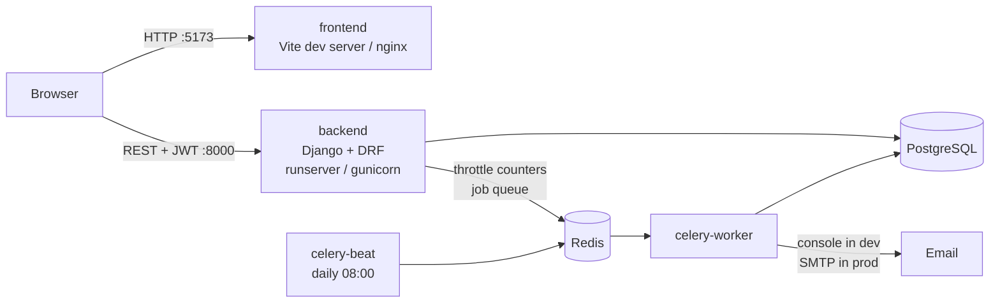
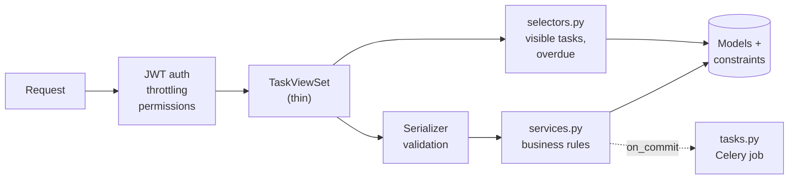

# Task Management System: Presentation

This is my thought process for the exercise, from reading the requirements to
the final checks, and the outline I follow when presenting the project.
Setup and the API reference are in [README.md](README.md); how I used AI tools
is in [GENAI.md](GENAI.md).

## 1. User story

> **As a member of a small team**, I want to create tasks, assign them to a
> colleague, set a priority and a due date, and mark them as completed,
> **so that** everyone knows what they own and what is late.

What that means in practice:

- I only see tasks that concern me: the ones I created and the ones assigned to me.
- I can find work quickly by filtering on status, due date or overdue, and by
  searching and sorting. Filtered views can be bookmarked.
- I'm told when someone assigns me a task, and once a day I get a reminder of
  my overdue work.
- Only the person who created a task can delete it. A team lead (staff user)
  can see and manage everything, including in the admin.
- It works on my phone as well as on my laptop.

## 2. Thought process

### 2.1 Start from the requirements, not from code

I began by putting the requirements in a versioned file,
[`project_instructions.md`](project_instructions.md), and reading it for gaps
before writing anything. Each open point went on a checklist with a suggested
answer: who can see which tasks, one assignee or several, which statuses,
how the frontend stores the token, what the background jobs do, and so on.
Once a point was settled, the decision went back into the same file. The
file is the single source of truth: anyone reviewing the code can see what
was intended and why.

### 2.2 Key decisions and trade-offs

| Decision | Why | Trade-off accepted |
|---|---|---|
| **Django 5.2 LTS**, not the newest Django | `drf-yasg` and SimpleJWT officially support up to 5.2. I checked compatibility before choosing versions instead of discovering problems later. | Not on the latest major version; 5.2 is LTS, so it is supported for years. |
| **Practical Clean Architecture** (models / selectors / services / api) | Business rules sit in services that don't import DRF, so the same rules serve the API, the admin, Celery jobs and management commands. Views stay thin. | Less abstraction than strict Clean Architecture (no repository interfaces or plain domain entities). Strict layering would fight the ORM and add a lot of code for a small domain. |
| **Visibility enforced in the queryset** | Another user's task returns 404, not 403, so task ids cannot be probed. Deleting is a separate permission (403 for an assignee). | Two mechanisms to understand instead of one. |
| **UUID primary keys** everywhere, including a custom `User` from the first migration | Ids can't be guessed or counted. Swapping the user model later is painful, so it was done first. | Slightly larger indexes than integer ids. |
| **Database constraint** for `completed_at` ⇔ `completed` | The invariant holds even if someone bypasses the API. | Status changes must go through the service, which keeps both fields in sync. |
| **JWT:** 15-minute access token in memory, 1-day rotating refresh token in `localStorage` | A script reading storage can't take the short-lived access token. A reload keeps the session. Rotation and blacklisting make logout real. | An XSS bug could still read the refresh token. httpOnly cookies would avoid that, but need CSRF handling and a same-site deployment. |
| **camelCase bodies, snake_case query parameters** | Natural on both sides: JavaScript objects, and Django filter names. | Clients must know about both conventions; it's documented in Swagger and the README. |
| **Lean frontend** (React + MUI + React Router only) | Fewer dependencies to learn and upgrade. The typed `fetch` client and small hooks are easy to read and test. | Some boilerplate that TanStack Query or React Hook Form would remove. |
| **Filters in the URL** | Bookmarkable, shareable, and they survive a reload. | They need parsing and validation (`taskFilters.ts`). |
| **Indexes only after measuring** | Indexes cost writes and storage, so each one has to show a gain. | Takes a benchmark instead of a guess (see 2.4). |
| **Rate limits fixed in code, stored in Redis** | Limits apply across all workers and can't be loosened by mistake in an environment file. | Changing a limit needs a deploy. |
| **Celery jobs queued with `transaction.on_commit`** | No email is sent for a write that rolls back, and the job reloads fresh data by id. | Tests must run the on-commit callbacks explicitly. |

### 2.3 How I worked

- **Test first.** Each feature started with a failing test, then the code,
  then the full suite and linters. 188 backend tests (100% coverage) and 127
  frontend tests (~98%).
- **One responsibility per commit.** 49 Conventional Commits on a feature
  branch, each passing on its own, so the history explains the project step by
  step.
- **Prove it in the real environment.** Passing unit tests weren't enough to
  call something done. I also started the Docker stack in development and
  production modes, drove the frontend in a headless browser at desktop and
  phone widths while watching the console, and measured queries with
  `EXPLAIN ANALYZE`.

### 2.4 What changed along the way

Several problems only showed up when I ran the real system, and each was fixed
in its own commit:

- **Browser console error on reload.** After a reload the first API call went
  out without an access token and failed with 401. The client now refreshes
  first when it only has a refresh token.
- **Docker quirks.** Poetry inside the container rebuilt the bind-mounted
  `.venv` as root, and containers left root-owned files in the repo. Poetry
  now ignores in-project virtualenvs, backend `make` commands run as the host
  user, and the frontend image runs as `node`.
- **Production health check.** The HTTPS redirect broke the container health
  check, so the frontend never started. The health endpoint is now exempt.
- **Indexes.** Measured on 200,000 tasks, the `status` and `due_date` indexes
  were 2–7× faster. `(assignee, status)` only became worthwhile (~19 ms →
  ~0.5 ms) after removing Django's automatic, redundant `assignee` index. The
  overdue digest gains nothing from an index, so it has none.
- **Safety.** `seed` now refuses to create the demo accounts, whose passwords
  are public, under production settings unless `--force` is passed.
- **Team conventions.** I aligned Docker Compose and the Makefile with the
  conventions my team already uses: one shared `.env`, no host ports for the
  database, and `make use-development` / `make use-production`.

## 3. Architecture

### 3.1 Services



`DJANGO_ENV` in `.env` selects the settings module and the image targets, so
the same `docker-compose.yml` runs both development and production.

### 3.2 Request flow in the backend



- **Reads** go through selectors: `visible_tasks_for(user)`, `overdue_tasks()`.
  The API, the admin filter and the daily digest share them.
- **Writes** go through services: `create_task`, `update_task`,
  `complete_task`, `delete_task`. They keep `completed_at` in sync and queue
  emails.
- **N+1 prevention:** the serializer declares the relations it reads, and
  `EagerLoadingViewMixin` applies them. Tests fix the list endpoint at 3
  queries, however many rows it returns.

### 3.3 Frontend structure

```
src/
├── api/             client.ts (fetch, JWT, refresh, errors) + one module per resource
├── auth/            AuthProvider, useAuth, RequireAuth
├── features/tasks/  components, hooks (useTasks, useUsers), pure helpers
├── components/      AppLayout, ConfirmDialog
└── pages/           LoginPage, TasksPage, NotFoundPage
```

Components never call `fetch` directly. Logic that can be a pure function
(formatting, filters, validation, permissions) lives outside components and is
tested on its own.

Tests sit in a `__tests__/` folder next to the code and come in two suites:
**unit** specs (`*.unit.spec.ts`) for helpers, hooks and API modules, and
**integration** specs (`*.integration.spec.tsx`) for components and pages
rendered with their providers. Each suite can run alone
(`make frontend-test-unit`, `make frontend-test-integration`), and the full run
enforces the coverage gate.

## 4. Demo script

Before the call: `make setup`. This builds the stack, applies migrations and
seeds the demo data.

1. **Login.** Open http://localhost:5173 and sign in as `alice / demo1234`.
   Show the task cards: status and priority chips, relative due dates, and an
   overdue task in red.
2. **Create and assign.** Create "Prepare demo" with high priority, a due date
   next week, and Bob Brown as assignee. In a terminal, run `make celery-logs`
   to show the assignment email printed by the worker.
3. **Filter.** Filter by Status = Pending, then Overdue = Only overdue, then
   search. Point at the URL (`?status=pending&overdue=true`), reload, and the
   filters are still there.
4. **Complete.** Complete a task. The card shows it struck through, and the
   success message appears.
5. **Validation.** Try a past due date or an empty title. The error shows next
   to the field.
6. **Permissions.** Log out and sign in as `bob / demo1234`. He sees "Fix
   login page layout", created by Alice and assigned to him. He can edit and
   complete it, but there is no Delete button. Mention that the API also
   returns 403, and returns 404 for tasks he can't see.
7. **Phone layout.** Open the browser's device toolbar at 375px. The filters
   stack, cards wrap, and the form opens full screen.
8. **API docs.** Open http://localhost:8000/api/docs/. Log in at
   `/auth/login/`, click Authorize, and call `GET /tasks/` with
   `status=completed`. Point out camelCase bodies, snake_case filters and the
   pagination fields.
9. **Rate limit.** Run six failed logins in Swagger (or with curl). The sixth
   returns 429.
10. **Admin and profiling.** Log in to http://localhost:8000/admin/ as
    `admin / admin123` and show the task changelist with its filters. Then
    open http://localhost:8000/silk/ to show the request timings and SQL
    queries.
11. **Quality.** Run `make test` and `make lint`, then show the CI workflow
    and `make benchmark-indexes` with its with/without comparison.
12. **Environments.** `make use-production` switches to gunicorn and the nginx
    build; `make use-development` switches back.

## 5. What I would do next

- **Pre-commit hooks** running black, isort, flake8 and ESLint before each commit.
- **An end-to-end suite** (for example Playwright) to keep the browser flow
  and console checks I ran by hand.
- **httpOnly cookie** for the refresh token in a production deployment.
- **OpenAPI 3** (drf-spectacular) if the drf-yasg requirement were lifted.
- **A maximum session length**, if the business needs one. Today a session
  lasts as long as the app is used at least once a day.
- **Product features:** comments on tasks, several assignees, notification
  preferences, and real-time updates.
